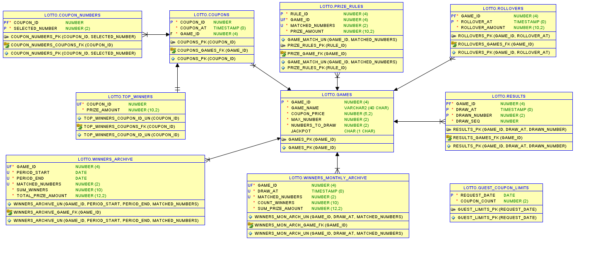

# Lottery Management System
### Oracle PL/SQL

## Overview

Lottery Management System is a backend application developed entirely in Oracle PL/SQL. The project simulates the core functionality of a lottery platform, including coupon generation, draw processing, winner calculation, jackpot rollovers, automated archiving, data cleanup, and job scheduling.

The system supports multiple lottery games with different configurations and demonstrates database-centric application design using Oracle packages, views, scheduler chains, procedures, constraints, and automated maintenance processes.

The live demo is powered by an Oracle APEX application built to showcase the running system.

---

## Key Features

### Coupon Generation
- Random coupon generation based on game configuration
- Manual coupon creation using user-selected numbers
- Validation of number ranges and uniqueness
- Storage of coupon details in normalized database structures

### Lottery Draw Processing
- Automated generation of draw results
- Support for multiple lottery games
- Configurable number ranges and draw counts

### Winner Calculation
- Matching coupon numbers against draw results
- Winner categorization based on matched numbers
- Prize calculation according to game rules
- Support for jackpot distribution among multiple winners

### Jackpot Rollover Logic
- Automatic rollover creation when no top winner exists
- Jackpot accumulation between draws
- Configurable maximum rollover limit

### Automated Archiving

Two-level archive strategy designed for OCI Autonomous Database Free Tier:

**Monthly Archive**
- Aggregates detailed winner data into monthly statistics
- Stores number of winners, total prize amounts, and match categories per draw

**Long-Term Archive**
- Aggregates monthly archive data into long-term historical records
- Retains archive periods, total winner counts, and total prize amounts

### Automated Cleanup
Removes historical operational data while preserving:
- Archived statistics
- High-value winning coupons
- Related coupon and draw information required for auditing

### Scheduler Automation

Oracle Scheduler automates all system workflows:

| Chain | Steps |
|-------|-------|
| Daily Lottery Chain | Generate draw results → Calculate winners |
| Monthly Archive Chain | Create monthly archive → Perform cleanup |
| Half-Year Archive Chain | Create long-term archive → Clean monthly archive |

---

## Technologies

- Oracle Database (OCI Autonomous Database Free Tier)
- PL/SQL Packages
- Oracle Scheduler — chains, programs, schedules, jobs
- Views, procedures, constraints, indexes

---

## Database Architecture

### Core Tables

| Table | Description |
|-------|-------------|
| `GAMES` | Lottery game configuration |
| `COUPONS` | Generated lottery coupons |
| `COUPON_NUMBERS` | Numbers assigned to coupons |
| `RESULTS` | Official draw results |
| `ROLLOVERS` | Jackpot rollover history |
| `TOP_WINNERS` | Jackpot and high-tier winning coupons |

### Archive Tables

| Table | Description |
|-------|-------------|
| `WINNERS_MONTHLY_ARCHIVE` | Monthly aggregated winner statistics |
| `WINNERS_ARCHIVE` | Long-term historical archive |

### Main Views

| View | Description |
|------|-------------|
| `MATCHED_WINNERS` | Coupons matched against draw results (min. 3 numbers) |
| `WINNERS_WITH_AMOUNT` | Winners with calculated prize amounts |
| `WINNING_NUMBERS` | Draw results pivoted into columnar format |

### Guest Views (last 7 days, read-only)

| View | Synonym | Description |
|------|---------|-------------|
| `V_RECENT_WINNING_NUMBERS` | `winning_numbers` | Winning numbers from the last 7 days |
| `V_RECENT_WINNERS_WITH_AMOUNT` | `winners_with_amount` | Winners with prize amounts from the last 7 days |
| `V_RECENT_ROLLOVERS` | `rollovers` | Jackpot rollover history from the last 7 days |

---

## Scheduler Architecture

```
Daily (19:00 Europe/Warsaw)
  draw_numbers
      └─► calculate_winners

Monthly (1st of month, 20:00 Europe/Warsaw)
  create_mon_arch
      └─► clean_mon_data

Half-Yearly (1 Jun / 1 Dec, 22:00 Europe/Warsaw)
  create_halfyear_archive
      └─► clean monthly archive
```

---

## Data Retention Strategy

| Level | Description |
|-------|-------------|
| Operational | Detailed coupon and winner records retained until monthly archive |
| Monthly Archive | Winner statistics aggregated monthly, retained until half-year archive |
| Long-Term Archive | Monthly statistics aggregated into historical records, retained indefinitely |
| Cleanup | Operational records removed after successful archiving; top winners preserved |

---

## Package API — `lotto_pkg`

### Public Procedures

| Procedure | Description |
|-----------|-------------|
| `generate_coupon(p_numbers, p_game_id)` | Generates coupon from manually provided numbers |
| `generate_random_coupon(p_game_id)` | Generates a random valid coupon for the selected game |
| `draw_numbers(p_game_id)` | Performs the official lottery draw |
| `calculate_winners(p_game_id)` | Calculates winners, payouts, and jackpot rollovers |
| `create_mon_arch` | Aggregates winner data into monthly archive |
| `clean_mon_data` | Removes operational data after archiving, preserving top winners |
| `create_halfyear_archive` | Aggregates monthly archives into long-term historical archive |

### Constants

| Constant | Value | Description |
|----------|-------|-------------|
| `c_big_lotto` | 10 | Game ID — Big Lotto |
| `c_express_lotto` | 20 | Game ID — Express Lotto |
| `c_max_rollover` | 10 000 000 | Maximum jackpot rollover amount |

### Usage Example

```sql
SET SERVEROUTPUT ON
DECLARE
    t_number lotto_pkg.numbers_array;
BEGIN
    t_number := lotto_pkg.numbers_array(1, 2, 3, 4, 5, 6);
    lotto_pkg.generate_coupon(t_number, p_game_id => lotto_pkg.c_big_lotto);
    lotto_pkg.generate_random_coupon(p_game_id => lotto_pkg.c_express_lotto);
END;
/
```

---

## Database Diagram



> Entity-relationship diagram showing all core and archive tables with primary keys, foreign keys, and unique constraints.

---

## Live Demo

The system is deployed on **Oracle Autonomous Database (OCI) Free Tier** and accessible via an Oracle APEX application. The demo allows exploring the running system without any local setup.

[Open APEX Application](https://gf146e63fcac365-oracleadb.adb.eu-frankfurt-1.oraclecloudapps.com/ords/r/lotto/lotto-demo-app/)

<details><summary style="color:orange;">Access Credentials</summary>
<p>
  
| Login | Password |
|-------|----------|
| `DEMO` | `demouser1234` |

</p>
</details>

### What You Can Do in the Demo

| Page | Description |
|------|-------------|
| Recent Winning Numbers | Browse draw results from the last 7 days |
| Recent Winners | View prize winners with payout amounts |
| Recent Rollovers | Current and historical jackpot rollover information |
| Generate Coupon | Submit your own numbers for Big Lotto or Express Lotto — up to 5 coupons per day |
| Number Frequency | Historical frequency of drawn and player-selected numbers per game |

### Guest User — Database Access Layer

`guest_user.sql` contains a reference implementation of a restricted database account designed for read-only public access. If provisioned, such an account would have strictly limited privileges with no access to base tables, `lotto_pkg`, or any other schema objects.

**Granted privileges:**

| Object | Privilege | Synonym |
|--------|-----------|---------|
| `V_RECENT_WINNING_NUMBERS` | `SELECT` | `winning_numbers` |
| `V_RECENT_WINNERS_WITH_AMOUNT` | `SELECT` | `winners_with_amount` |
| `V_RECENT_ROLLOVERS` | `SELECT` | `rollovers` |
| `GUEST_PKG` | `EXECUTE` | `guest_pkg` |

All views are `WITH READ ONLY` and filtered to the last 7 days. Coupon generation is limited to **5 coupons per day** enforced inside `guest_pkg`.

**Resource limits** via Oracle Resource Manager (`CS_RESOURCE_MANAGER`):

| Parameter | Value |
|-----------|-------|
| Active session limit | 1 |
| Elapsed time limit | 2s |
| Parallel queue timeout | 3s |
| Timeout action | CANCEL |
| Resource shares | 1 (vs. 5 for other users) |

---

## Testing

The project includes documented unit test scenarios covering:

- Coupon generation (number count, uniqueness, range validation, FK integrity)
- Winner calculation and jackpot payout distribution
- Jackpot rollover logic and maximum cap enforcement
- Monthly archive aggregation and deduplication
- Long-term archive correctness and period assignment
- Cleanup — operational data removal with top winner preservation
- Scheduler execution — jobs, chains, and program invocation
- Constraint validation — PK, FK, UNIQUE, CHECK, NOT NULL

All 40 test criteria passed. Validation performed using SQL assertion queries on controlled test datasets.

---

## Deployment

The solution is deployed and tested on **Oracle Autonomous Database (OCI) Free Tier**.  
Automated scheduler chains execute archive and maintenance workflows without manual intervention.

---

## Learning Objectives

This project was created to practice and demonstrate:

- Advanced PL/SQL development and package design
- Oracle Scheduler chains and workflow automation
- Data archiving strategies for constrained environments
- Database performance optimization with indexes and views
- Relational database design and constraint enforcement
- Oracle Autonomous Database deployment

---

*Personal portfolio project — Oracle PL/SQL backend development and database automation.*